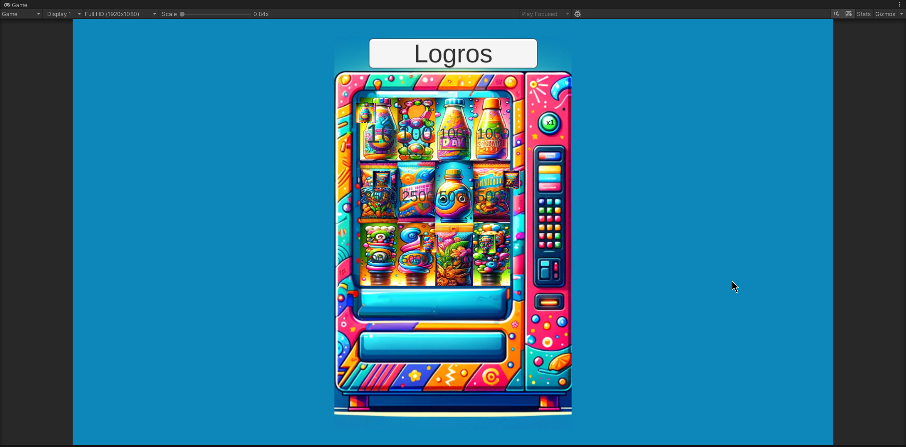
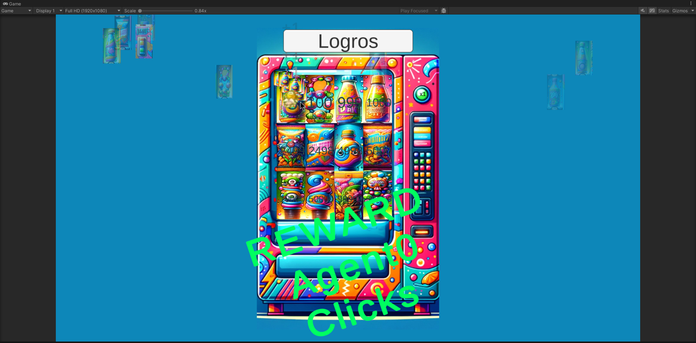

# 🥤 ClickerBebidas

Un juego clicker desarrollado en Unity con mecánicas de idle, agentes automatizados y sistema de logros gamificado.

## 📱 Screenshots

### Pantalla Inicial


### Sistema de Recompensas


### Logros Menores


### Efectos Completos


### Todas las Recompensas


## 🎮 Características Principales

### Sistema de Clicks Core
- **Botones interactivos** con contadores dinámicos
- **Click Ratio** que multiplica el poder de cada click
- **Stock limitado** de 5 usos por botón con dificultad incremental (+15%)

### Sistema de Recompensas
- **Plus**: Suma puntos al ratio de clicks
- **Multi**: Multiplica el ratio existente  
- **Agent**: Invoca agentes automatizados (Ángel/Unicornio)

### Agentes Automatizados
- **Workers IA** que realizan clicks automáticos
- **Movimiento dinámico** hacia nuevos objetivos
- **Rate configurable** de velocidad de clicks

### Sistema de Logros "Yellow Rewards"
- **Por cantidad**: 100, 1K, 10K, 100K clicks
- **Por progreso**: Completar filas de botones
- **Por tiempo**: 1+ horas de juego
- **Por colección**: Obtener primer Ángel/Unicornio

### Efectos Visuales y Audio
- **Sistema de partículas** con intensidad variable
- **Shake de cámara** proporcional al poder de click
- **Object Pooling** optimizado para puntos flotantes
- **Feedback audio** para recompensas y eventos

## 🛠️ Instalación y Configuración

### Requisitos
- **Unity 2022.3 LTS** o superior
- **DOTween** (incluido en el proyecto)
- **TextMeshPro** (incluido en Unity)

### Clonar el Proyecto
```bash
git clone https://github.com/LorenaPerezHernando/ClickerBebidas.git
cd ClickerBebidas
```

### Abrir en Unity
1. Abre Unity Hub
2. Selecciona "Open" y navega a la carpeta del proyecto
3. Abre la escena principal en `Assets/Scenes/`

## 🏗️ Arquitectura del Proyecto

### Estructura de Scripts
```
Assets/Scripts/SuperClicker/
├── GameController.cs      # Controlador principal del juego
├── SlotButtonUI.cs       # Lógica de botones clickeables
├── Agent.cs              # Comportamiento de agentes IA
├── Reward.cs             # Definición de tipos de recompensas
├── RewardPanel.cs        # Sistema de logros "Yellow Rewards"
└── PointsElementUI.cs    # UI de puntos flotantes
```

### Mecánicas de Progresión
- **Dificultad escalable**: Incremento automático del 15% por uso
- **Desactivación gradual**: Los botones se agotan tras 5 usos
- **Feedback visual**: Colores amarillos para logros conseguidos

## 🎯 Cómo Jugar

1. **Haz click** en los botones de bebidas para reducir su contador
2. **Consigue recompensas** al llegar a 0 clicks en cada botón
3. **Mejora tu Click Ratio** con las recompensas Plus y Multi
4. **Invoca agentes** que trabajen automáticamente por ti
5. **Desbloquea logros** haciendo clicks, completando filas y jugando tiempo

## 📊 Sistema de Logros

### Logros por Clicks
- ✅ 100 clicks → Texto amarillo
- ✅ 1,000 clicks → Texto amarillo
- ✅ 10,000 clicks → Texto amarillo
- ✅ 100,000 clicks → Texto amarillo

### Logros por Progreso
- ✅ Primera fila completada
- ✅ Segunda fila completada
- ✅ Tercera fila completada

### Logros por Tiempo
- ✅ 1 hora de juego
- 🔄 2 horas de juego (en desarrollo)

### Logros por Colección
- ✅ Primer Ángel obtenido
- ✅ Primer Unicornio obtenido

## 🔧 Configuración Técnica

### Variables Principales
- `ClickRatio`: Multiplicador de poder de click
- `RepeatRate`: Velocidad de agentes automatizados
- `_initialClicks`: Clicks requeridos por botón
- `_stock`: Usos restantes por botón

### Eventos del Sistema
- `OnSlotReward`: Evento de recompensa obtenida
- `OnSlotClicked`: Evento de click en botón

## 📈 Historial de Commits Importantes

- **22/11/2024**: "Yellow Rewards" - Sistema de logros con feedback visual
- **21/11/2024**: "Finni" - Finalización de mecánicas principales
- **21/11/2024**: "Agente 1 funcional" - Implementación de agentes IA
- **20/11/2024**: "Juego !/2" - Mecánicas core del clicker

## 👨‍💻 Créditos

Desarrollado por **Lorena P** (lorena.1997.lore@gmail.com)

---

### 🚀 Estado del Proyecto
**Rama Actual**: `develop`  
**Última Actualización**: Noviembre 2024  
**Estado**: ✅ Funcional - En desarrollo activo